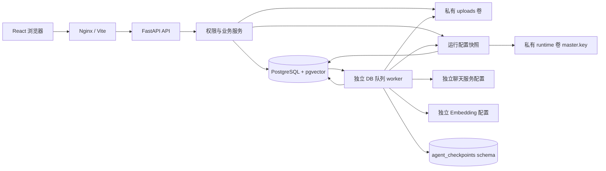

# 架构

知簇是面向本机单用户的知识工作区。生产式 Demo 使用 React Web、FastAPI API、独立 Python worker、PostgreSQL 四个常驻服务，另有一次性迁移初始化任务。服务宿主端口仅发布到 `127.0.0.1`；不提供公开部署认证。

## 后端分层与执行方式

- `api/`：Pydantic 输入、路由、错误映射和 SSE。上传请求只验证/保存文件与创建任务，不在 API 进程执行长文档解析。
- `services/`：知识库权限、目录树、手动元数据操作、聊天和运行配置服务；API 与 Agent 共用相同业务边界。`chat_context.py` 单独约束追问、历史和证据预算；`trash.py` 负责回收站查询及事务删除，`storage_cleanup.py` 负责已确认原文件的有限清理。
- `db/`：SQLAlchemy 2 模型、同步 Session 与初始化 seed。采用同步事务减少 Demo 多阶段状态管理复杂度；FastAPI 同步路由在线程池中执行，长任务由独立 worker 处理。
- `ingestion/`：真实文件解析、来源锚点、token 切块、层级摘要与结构化分类建议；`parallel.py` 提供有界并行映射，数据库写入仍由协调线程负责。
- `ai/`：HTTPX OpenAI 兼容聊天与向量适配器；两个服务独立配置，密钥只在后端使用。`concurrency.py` 在进程内跨网关实例共享模型调用额度，区分交互和后台任务。没有模型配置时抛明确异常，不生成替代 AI 业务结果。
- `retrieval/`：`terms.py` 规划查询词和复合子问句，`ranking.py` 负责词面打分、融合、多样性和片段；`search.py` 负责范围 SQL 与检索协调，`evidence.py` 提供可选、有界模型证据重排。
- `agent/`：LangChain `create_agent` 的只读工具规划、Pydantic 计划、LangGraph 审批流程、事务执行器、审计与撤销。
- `worker/`：`queue.py` 负责持久领取和租约，`scheduler.py` 负责交互/入库两个并发通道及心跳，`pipeline.py` 负责分阶段提交和恢复，`embeddings.py` 负责并发 profile 创建的冲突处理。

当前保留清晰的模块边界，未为小规模 Demo 增加独立 repository 类、Redis、Celery 或专用搜索引擎。SQL 查询位于相应服务或管线模块。

## 数据与权限

26 张业务表均由 Alembic 管理；详细关系见 [data-model.md](data-model.md)。`agent_checkpoints` 专用 schema 由安装版本的 `PostgresSaver.setup()` 初始化，保存图工作流进度。它不替代对话、计划、审计或撤销表。

本地身份由服务端固定 demo actor 获取，不读取前端任意传入的 `user_id`。知识库 membership 的 owner/editor/viewer 决定服务层权限；目录、标签与文档关联有同库校验，PostgreSQL 复合外键提供额外约束。免登录模式仅接受 local/test 环境；非本地环境启动失败，CORS 和 Host 也限制来源。

原始文件使用服务端生成的 `<kb_uuid>/<document_uuid>/original` 存储键，置于 `/data/uploads` 私有卷。文件名只用于显示与下载响应。读取、下载、搜索、聊天引用和 Agent 工具经过权限服务；源文件不作为静态目录公开。

## 运行配置与快照生命周期

`core/config.py:get_settings()` 仍只缓存启动环境，数据库引擎、网络、CORS、上传位置和限制从这一基础配置初始化。`services/runtime_config.py` 在明确的业务边界读取数据库单例，合并模型及 processing 字段，返回调用方独立持有的深拷贝；不会修改启动配置，也不通过全局缓存传播网页保存结果。LLM 和 Embedding 的地址、模型、密钥、超时与重试设置独立。

网页 GET 读取公开配置及 revision；PUT 校验可写字段后，通过条件更新保证乐观并发，事务提交后才返回成功。首次保存持久化当时完整的有效运行配置，后续启动环境变化不覆盖已保存的这些字段。模型密钥用 Fernet 加密存入数据库，master.key 位于 API/worker 共享的私有 runtime 卷；返回浏览器的结构仅含是否配置密钥。配置保存不发起模型调用，草稿连接测试在一次请求内合并临时配置，只探测选中的服务且不落库。

配置读取边界如下：

1. API 的模型状态、Agent 创建前检查和独立检索请求读取当次最新配置；一次请求内部持有同一快照。
2. worker 每次轮询领取任务前读取最新配置，使用其重试参数领取任务，再把该快照传给本次 ingest/reindex/chat/agent 执行尝试。已排队但尚未领取的任务使用领取时配置，而非排队时配置。
3. 入库的分块、向量批次、摘要预算和模型网关保持该快照；聊天的检索和流式回答保持该快照；Agent 的聊天模型及其只读检索工具也使用同一快照。保存新配置不会替换执行中的对象，心跳闭包同样持有本次参数。
4. 执行尝试结束后，下次领取重新读取数据库。崩溃、租约回收或显式重试开始新的执行尝试，可能使用更新后的配置；当前不持久化每个任务的历史配置或 revision。Agent 已生成并等待审批的业务计划仍以保存的最终计划及实体版本执行，不在批准时重新向模型生成计划。

worker 的两个通道容量属于启动配置：`WORKER_INGESTION_CONCURRENCY` 默认 3（有效范围 1–16），处理 ingest/reindex；`WORKER_INTERACTIVE_CONCURRENCY` 默认 1（有效范围 1–8），处理 chat/agent。调整后重启 worker，不属于网页运行配置字段。通道有空闲线程时才领取任务，防止任务持有租约却排在执行器内部等待。每个任务使用独立 Session、owner 和续约线程；同一文档的 ingest/reindex 通过任务及文档行锁串行领取。优雅停止会等待已领取任务完成，等待期间保持续约。

`MAX_CONCURRENT_MODEL_CALLS` 与上面的任务线程数分别生效。相同连接配置和限额的网关实例在同一进程内共享额度；后台最多占用 `max(1,限额−1)` 个槽，等待中的交互请求优先取得后续空闲槽。限额至少为 2 时可为交互保留一个槽，限额为 1 时不能预留或抢占正在执行的请求。API 和 worker 是不同进程，各自执行限额；这不是部署全局或服务商账户级限流。配置改变时，旧请求完成并归还原额度，新快照使用相应额度。

更改分块参数不会自动重切已有 chunks，显式 Embedding 重建也只补向量。更换 Embedding 地址/名称/维度会选择新 fingerprint，旧索引保留但不混入当前检索，用户应显式重建。`supports_tools` 是保存的能力声明；连接测试结果本身不会自动改写它，实际 Agent 仍要求模型返回可验证的工具调用计划。

数据库与 runtime 主密钥需要配套备份；初始化采用私有临时文件加原子发布，阻止 API/worker 同时创建不同 key。缺少密钥文件、权限错误或密文不能解密时返回可区分的 503，相关 API 配置读取失败、worker 暂停领取，不静默使用环境旧密钥。普通数据库管理资源仍可使用；模型状态、检索等依赖运行配置的请求需先恢复正确主密钥。`/api/ready` 仅检查数据库与 demo actor，不替代配置读取和连接测试。当前不提供网页重置丢失主密钥、历史配置回滚或自动轮换功能。

## 入库与恢复

任务状态和事件保存在数据库，worker 使用 `FOR UPDATE SKIP LOCKED` 领取并写入 owner/lease，后台线程续约。多个文档可以同时入库，聊天使用独立通道。单个文档的阶段依次为 parsing、chunking、embedding、summarizing、classifying。正常终态为 completed；缺 Key 或 AI 子阶段失败时可为 partial_ready，已完成解析与关键词检索仍可使用。

四格式分别提供真实来源精度：PDF 页码；DOCX 标题与段落范围；Markdown 标题层级与行号；TXT 行号。PDF 无文本层明确报错，不尝试 OCR。切块默认约 800 tokens、100 tokens 重叠，按句段边界优先截取。

原文解析完成后持久化 sections，再持久化 chunks。若两次提交之间崩溃，可从已保存 sections 重建 chunks。Embedding 按批提交并报告真实的已完成/总 chunk 数；重试只补当前 profile 缺失的 chunk。多个文档同时首次创建 profile 时，嵌套事务仅回滚冲突插入并复用同一 profile，不丢弃外层任务状态。

可放入摘要输入预算的短文档直接进行一次结构化摘要，无须对每个段落或 PDF 页面分别请求模型。长文档的缺失章节摘要通过有界线程并行计算，完成后由协调线程逐次保存，树形聚合仍受输入和调用次数预算约束。AI 分类只保存 pending suggestion，人工应用时重新校验文档版本及同库目标。

## 检索、聊天与事件

关键词检索对查询进行 NFKC 归一化、弱化口语填充词，并在中文短语与 n-gram 间分配预算；内容和文件名的 ILIKE 由 trigram GIN 索引辅助。内容匹配、子问题覆盖及词面重排参与排序；申请/申报/登记模板与规则类问题存在用途差异时软降权，明确找表或填写问题不降权，统计数据表不受此先验影响。单个文档进入候选池的片段数有上限，融合后再折减同文档及近重复片段的占用。语义检索使用 pgvector 无固定维度的 vector 列、模型 profile 以及精确 cosine 排序；复合问题可将全文及最多两个子问句放入同一次 Embedding 批量请求。当前未创建 HNSW 索引。

更改模型地址/名称/维度产生不同 fingerprint；当前 profile 不存在时明确降级为关键词搜索，用户显式重建索引。向量插入和查询均验证维度，不混用旧模型数据。

默认聊天与搜索不增加证据筛选模型调用。`/api/search` 明确传入 `rerank=true` 后，可在本地融合后额外进行一次有界的模型证据重排：最多 8 个候选、输入总计不超过 4,000 字符，输出限 400 tokens，超时不超过 12 秒且不重试，只接受已有候选 ID。无模型时跳过，响应不合法或失败时保留本地排序；有效空列表表示没有足够证据。Embedding 及重排网络请求后重新检查最初的 KB 权限、删除状态、目录和标签筛选，不因网络等待返回过期范围内的来源。

聊天 POST 创建消息及任务，独立 worker 持久化 scope、keyword、可选 embedding、ranking、可选 reranking、context、generation 等真实阶段及耗时。短的明确追问可继承前一个主题，独立问题不自动拼入旧问题；证据正文预算约 24,000 字符，历史对话预算约 6,000 字符。阶段信息不包含模型隐藏推理，也不虚构进度百分比。

首个输出片段立即提交，后续 token 按约 120 ms 或累计 256 字符合批提交；SSE token 带 UTF-16 字符偏移，消息检索元数据保存事件水位。前端约 60 ms 合批后更新同一 assistant 消息，结合水位与偏移处理快照、重连及重复事件，避免每个 token 重渲染整段 Markdown 或追加独立气泡。完成后过程默认收起，仍可展开查看；刷新从消息的 execution 数据恢复。断开浏览器订阅不取消任务，删除会话则结束当前 owner 的生成并释放租约，owner 交接时不覆盖新执行者。

生成前保存并发布真实候选来源，正文 `[S1]` 等标记可在生成时点击；完成时只保留实际使用的白名单引用。文件名/位置来自 chunk 关联，正文代码块和链接内不做引用转换。历史消息及来源事件重放都重新检查可用性，失效来源禁用并遮蔽片段，来源列表使用紧凑行展示。

## 回收站与原文件清理

回收站是独立页面，按文档、文件夹、知识库三类分页搜索，仅列出当前 actor 同时具有 owner 身份及 ownership 的资源。已删除知识库作为整体显示，不再把其内部文档和目录重复平铺；知识库行返回文档/目录数量。恢复继续使用现有恢复接口，父目录和知识库需先可用。

永久删除要求明确的 `confirm:true`，支持指定项目和全部清空。服务取得 namespace 锁后复核删除状态；文件夹子树内出现已恢复内容时拒绝整次删除，执行中任务或被其他事务锁定的资源返回冲突。删除顺序覆盖来源引用、向量、章节、标签关联、任务和相应审计/撤销记录；知识库整体删除再处理 Agent 关联。保留的聊天正文中，已删除来源不能再打开。

数据库删除与 `StorageDeletion` 待清理记录在同一事务提交。随后只清理当前用户已确认项目的原文件，每次最多 64 条；路径必须符合私有原件键结构，拒绝目录符号链接/联接，只删除具体文件及空父目录。清理失败保留 attempts/error，不回滚已经完成的元数据删除。API 返回 `pending_file_cleanup`；再次明确确认清空时重试剩余记录。当前没有后台自动删除线程或定时清理任务。

## Agent 审批

LangChain 只读工具可列举和搜索授权范围内资料，没有 Shell/SQL/Python 执行工具。模型输出结构化计划，LangGraph 在 Review 节点 interrupt，整批审批后进入 Execute/Verify。用户编辑后的最终计划保存在业务表，执行器读取该版本；创建文件夹、移动、打标、重命名与软删除在事务中执行。

审批检查文档/目录/标签版本、归属、依赖与风险；软删除要求额外明确确认。数据库锁、计划状态和幂等结果阻止重复执行。撤销读取独立 before 快照，并校验后续版本，发生人工修改时拒绝危险覆盖。图 thread 使用 PostgreSQL advisory lock 防止多个请求同时恢复同一流程。

## 前端与运行边界

前端使用 React、TypeScript、Vite、React Router、TanStack Query、Zustand、Tailwind、Radix/shadcn 风格组件、Lucide、Sonner 和安全 Markdown 预览。远端状态来自 API；主题、面板宽度和折叠状态保存在 localStorage。Nginx 代理 `/api` 并关闭 SSE 缓冲。

Compose 完整模式构建静态前端，开发覆盖文件 bind mount 前后端源码并启用 Vite HMR、Uvicorn reload 和 worker 文件监听重启。应用状态位于 PostgreSQL、uploads 和 runtime 三个持久卷；开发模式也保留共享 uploads/runtime 挂载。runtime 只供后端使用，不通过 Web 静态发布。

当前仍面向个人资料规模：精确向量扫描、DB 轮询队列、同步数据库服务和有限成本摘要需要按实际文档量评估。大规模索引、OCR、多用户认证/共享和分布式限流/队列尚未提供。并发与排序机制的实现不等于已证明真实召回改善，真实模型质量、延迟和兼容提供方行为应以单独的验收记录为准。
