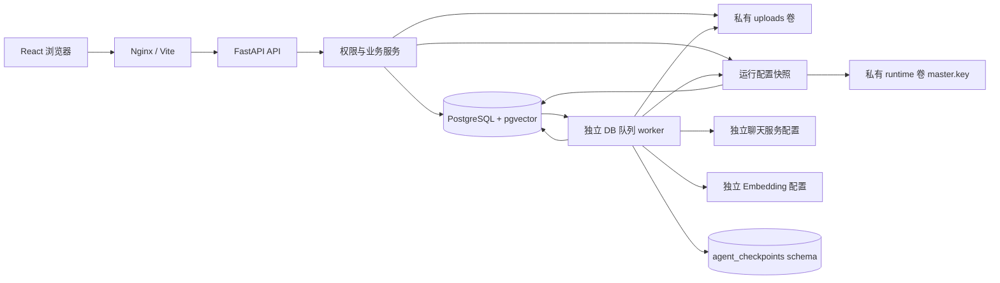

# 架构

知簇是面向本机单用户的知识工作区。生产式 Demo 使用 React Web、FastAPI API、独立 Python worker、PostgreSQL 四个常驻服务，另有一次性迁移初始化任务。服务宿主端口仅发布到 `127.0.0.1`；不提供公开部署认证。

## 后端分层与执行方式

- `api/`：Pydantic 输入、路由、错误映射和 SSE。上传请求只验证/保存文件与创建任务，不在 API 进程执行长文档解析。
- `services/`：知识库权限、目录树、手动元数据操作、存储、聊天和运行配置服务；API 与 Agent 共用相同业务边界。
- `db/`：SQLAlchemy 2 模型、同步 Session 与初始化 seed。采用同步事务减少 Demo 多阶段状态管理复杂度；FastAPI 同步路由在线程池中执行，长任务由独立 worker 处理。
- `ingestion/`：真实文件解析、来源锚点、token 切块、层级摘要与结构化分类建议。
- `ai/`：HTTPX OpenAI 兼容聊天与向量适配器；两个服务独立配置，密钥只在后端使用。没有模型配置时抛明确异常，不生成替代 AI 业务结果。
- `retrieval/`：在 SQL 中先约束权限范围，再做关键词与当前 profile 的精确向量检索；RRF 合并 chunk 候选。
- `agent/`：LangChain `create_agent` 的只读工具规划、Pydantic 计划、LangGraph 审批流程、事务执行器、审计与撤销。
- `worker/`：持久化任务领取、租约心跳、分阶段提交、恢复、有限重试及入库/聊天/Agent 派发。

当前保留清晰的模块边界，未为小规模 Demo 增加独立 repository 类、Redis、Celery 或专用搜索引擎。SQL 查询位于相应服务或管线模块。

## 数据与权限

25 张业务表均由 Alembic 管理；详细关系见 [data-model.md](data-model.md)。`agent_checkpoints` 专用 schema 由安装版本的 `PostgresSaver.setup()` 初始化，保存图工作流进度。它不替代对话、计划、审计或撤销表。

本地身份由服务端固定 demo actor 获取，不读取前端任意传入的 `user_id`。知识库 membership 的 owner/editor/viewer 决定服务层权限；目录、标签与文档关联有同库校验，PostgreSQL 复合外键提供额外约束。免登录模式仅接受 local/test 环境；非本地环境启动失败，CORS 和 Host 也限制来源。

原始文件使用服务端生成的 `<kb_uuid>/<document_uuid>/original` 存储键，置于 `/data/uploads` 私有卷。文件名只用于显示与下载响应。读取、下载、搜索、聊天引用和 Agent 工具经过权限服务；源文件不作为静态目录公开。

## 运行配置与快照生命周期

`core/config.py:get_settings()` 仍只缓存启动环境，数据库引擎、网络、CORS、上传位置和限制从这一基础配置初始化。`services/runtime_config.py` 在明确的业务边界读取数据库单例，合并模型及 processing 字段，返回调用方独立持有的深拷贝；不会修改启动配置，也不通过全局缓存传播网页保存结果。LLM 和 Embedding 的地址、模型、密钥、超时与重试设置独立。

网页 GET 读取公开配置及 revision；PUT 校验可写字段后，通过条件更新保证乐观并发，事务提交后才返回成功。首次保存持久化当时完整的有效运行配置，后续启动环境变化不覆盖已保存的这些字段。模型密钥用 Fernet 加密存入数据库，master.key 位于 API/worker 共享的私有 runtime 卷；返回浏览器的结构仅含是否配置密钥。配置保存不发起模型调用，草稿连接测试在一次请求内合并临时配置，只探测选中的服务且不落库。

配置读取边界如下：

1. API 的模型状态、Agent 创建前检查和独立检索请求读取当次最新配置；一次请求内部持有同一快照。
2. worker 每次轮询领取任务前读取最新配置，使用其重试参数领取任务，再把该快照传给本次 ingest/reindex/chat/agent 执行尝试。已排队但尚未领取的任务使用领取时配置，而非排队时配置。
3. 入库的分块、向量批次、摘要预算和模型网关保持该快照；聊天的检索和流式回答保持该快照；Agent 的聊天模型及其只读检索工具也使用同一快照。保存新配置不会替换执行中的对象，心跳闭包同样持有本次参数。
4. 执行尝试结束后，下次领取重新读取数据库。崩溃、租约回收或显式重试开始新的执行尝试，可能使用更新后的配置；当前不持久化每个任务的历史配置或 revision。Agent 已生成并等待审批的业务计划仍以保存的最终计划及实体版本执行，不在批准时重新向模型生成计划。

更改分块参数不会自动重切已有 chunks，显式 Embedding 重建也只补向量。更换 Embedding 地址/名称/维度会选择新 fingerprint，旧索引保留但不混入当前检索，用户应显式重建。`supports_tools` 是保存的能力声明；连接测试结果本身不会自动改写它，实际 Agent 仍要求模型返回可验证的工具调用计划。

数据库与 runtime 主密钥需要配套备份；初始化采用私有临时文件加原子发布，阻止 API/worker 同时创建不同 key。缺少密钥文件、权限错误或密文不能解密时返回可区分的 503，相关 API 配置读取失败、worker 暂停领取，不静默使用环境旧密钥。普通数据库管理资源仍可使用；模型状态、检索等依赖运行配置的请求需先恢复正确主密钥。`/api/ready` 仅检查数据库与 demo actor，不替代配置读取和连接测试。当前不提供网页重置丢失主密钥、历史配置回滚或自动轮换功能。

## 入库与恢复

任务状态和事件保存在数据库，worker 使用 `FOR UPDATE SKIP LOCKED` 领取并写入 owner/lease，后台线程续约。阶段依次为 parsing、chunking、embedding、summarizing、classifying。正常终态为 completed；缺 Key 或 AI 子阶段失败时可为 partial_ready，已完成解析与关键词检索仍可使用。

四格式分别提供真实来源精度：PDF 页码；DOCX 标题与段落范围；Markdown 标题层级与行号；TXT 行号。PDF 无文本层明确报错，不尝试 OCR。切块默认约 800 tokens、100 tokens 重叠，按句段边界优先截取。

原文解析完成后持久化 sections，再持久化 chunks。若两次提交之间崩溃，可从已保存 sections 重建 chunks。Embedding 按批提交；重试只补当前 profile 缺失的 chunk。章节摘要逐次保存；树形摘要输入与调用次数有配置预算。AI 分类只保存 pending suggestion，人工应用时重新校验文档版本及同库目标。

## 检索、聊天与事件

关键词检索使用 PostgreSQL `pg_trgm` 相似度和 ILIKE，覆盖中文文件名与中文内容；对内容和名称创建 trigram GIN 索引。语义检索使用 pgvector 无固定维度的 vector 列、模型 profile 以及精确 cosine 排序；当前未创建 HNSW 索引，优先保证维度隔离和范围正确性。

更改模型地址/名称/维度产生不同 fingerprint；当前 profile 不存在时明确降级为关键词搜索，用户显式重建索引。向量插入和查询均验证维度，不混用旧模型数据。

聊天 POST 创建消息及任务，独立 worker 检索并流式调用聊天模型。token、citation、完成和错误写入事件表，SSE GET 按事件序号回放；刷新可重新获取已保存消息。引用只接受检索结果中的 `[S1]` 等白名单标记，文件名/位置由 chunk 真实关联生成。

## Agent 审批

LangChain 只读工具可列举和搜索授权范围内资料，没有 Shell/SQL/Python 执行工具。模型输出结构化计划，LangGraph 在 Review 节点 interrupt，整批审批后进入 Execute/Verify。用户编辑后的最终计划保存在业务表，执行器读取该版本；创建文件夹、移动、打标、重命名与软删除在事务中执行。

审批检查文档/目录/标签版本、归属、依赖与风险；软删除要求额外明确确认。数据库锁、计划状态和幂等结果阻止重复执行。撤销读取独立 before 快照，并校验后续版本，发生人工修改时拒绝危险覆盖。图 thread 使用 PostgreSQL advisory lock 防止多个请求同时恢复同一流程。

## 前端与运行边界

前端使用 React、TypeScript、Vite、React Router、TanStack Query、Zustand、Tailwind、Radix/shadcn 风格组件、Lucide、Sonner 和安全 Markdown 预览。远端状态来自 API；主题、面板宽度和折叠状态保存在 localStorage。Nginx 代理 `/api` 并关闭 SSE 缓冲。

Compose 完整模式构建静态前端，开发覆盖文件 bind mount 前后端源码并启用 Vite HMR、Uvicorn reload 和 worker 文件监听重启。应用状态位于 PostgreSQL、uploads 和 runtime 三个持久卷；开发模式也保留共享 uploads/runtime 挂载。runtime 只供后端使用，不通过 Web 静态发布。

首版是小规模本地 Demo：精确向量扫描、DB 轮询队列、同步数据库服务和有限成本摘要适合个人资料规模。大规模索引、OCR、多用户认证/共享、分布式队列、永久删除均不在当前产品范围。真实云端质量和兼容提供方行为仍需填写凭据后验收，测试 fake provider 的成功不代表联网模型验收。
