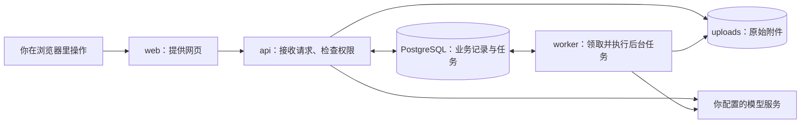
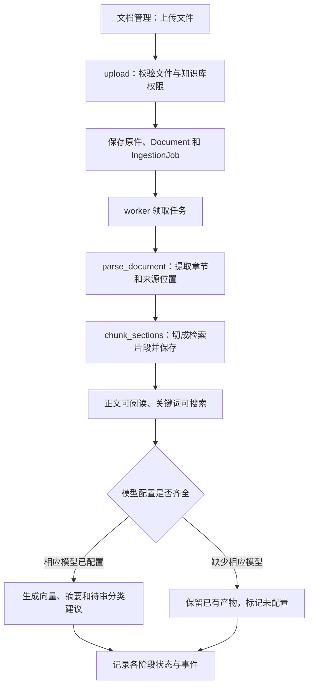
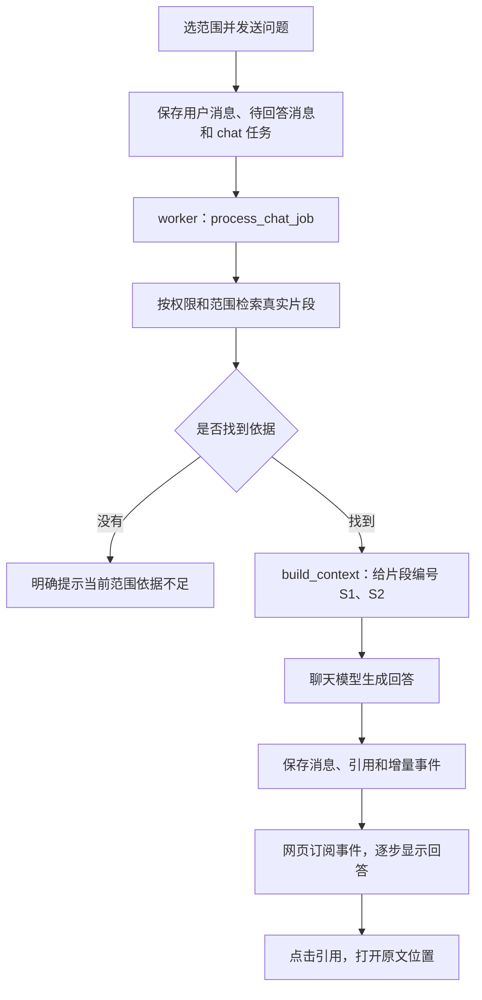
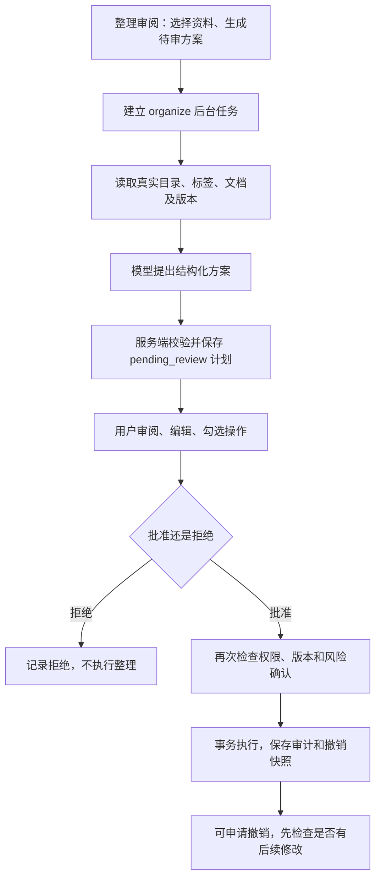

# 知簇入门：从第一次启动，到读懂核心代码

> 面向第一次接触这个项目的你。本文依据 2026-10-24 的实际源码、依赖声明和配置文件编写；示例终端为 Windows PowerShell。先完成第 2～3 节的小练习，再往后读，不需要提前学会所有技术。

阅读路线：

- 先体验：[启动项目](#2-快速上手先把项目跑起来) → [上传第一份笔记](#3-第一次使用用一份小笔记走完整条路)。
- 再理解：[目录协作](#4-项目结构网页服务和数据怎样配合) → [技术分工](#5-技术栈每种工具各管一件事) → [核心流程](#6-核心流程沿着一次操作追踪数据) → [源码导读](#7-代码导读第一次从哪里看)。
- 开始探索：[设计思路](#8-进阶探索理解那些不显眼但重要的设计) → [开发与练习](#9-开始动手开发方式小练习与检查)。遇到卡点可直接看[问题排查](#10-遇到问题先查这几处)。

## 1. 项目介绍：它帮你把资料用起来

假设你收集了课程笔记、论文和使用手册。文件虽然都在电脑里，真正要用时，却经常想不起“那句话在哪份资料的哪一页”。

**知簇（ZhiCluster）是一个本地优先的知识工作区**：把文件集中管理，提取能搜索的正文，再根据你指定的资料范围查找内容。连接模型后，还能根据原文回答问题、生成摘要，并提出整理建议。

你可以把它想成一间小资料室：

- **知识库**是一组独立的资料柜，例如“课程资料”和“毕业论文”。
- **文件夹**是柜子里的分区，一个文档最多放在一个文件夹里。
- **标签**是贴纸，一份资料可以同时贴“待复习”“数据库”等多个标签。
- **搜索和问答**是帮助查资料的助手；回答中的引用号可以带你回到原文。
- **整理审阅**是助手递来的整理清单，你看过并批准后才执行。

### 1.1 当前可以做什么

| 功能 | 具体例子 | 需要模型吗 |
| --- | --- | --- |
| 管理资料 | 新建知识库、文件夹和标签，上传、移动、重命名、下载文件 | 不需要 |
| 解析与阅读 | 阅读文档、表格、幻灯片、网页、JSON和电子书正文，并保留来源位置 | 不需要 |
| 关键词搜索 | 输入“苹果”，找正文或文件名里相关的片段 | 不需要 |
| 语义检索 | 用表达不同但意思接近的问题查资料 | 需要向量模型及对应索引 |
| 知识问答 | 针对选定资料提问，查看带来源引用的回答 | 需要聊天模型；向量模型可增强检索 |
| 摘要与标签建议 | 联合生成摘要和标签建议，保留上传目录，等待人工审阅 | 需要聊天模型 |
| 整理方案 | 为选定文档提出移动、建目录、加标签等方案 | 需要能输出 JSON 的聊天模型 |
| 任务与回收站 | 查看处理进度、重试或取消任务、恢复误删资料 | 管理操作不需要；重试的 AI 阶段仍需要模型 |

### 1.2 先认识几个实际边界

当前是**免登录的本机单用户 Demo**。初始化会创建“本地用户”和“我的知识库”；虽然代码已有知识库权限检查，但没有完整的真实登录、多人共享系统。默认端口只绑定本机，后端也检查访问来源，不适合直接公开到互联网。

“本地优先”表示原文件、业务记录和索引由本地服务保存。配置远程模型后，相关文本仍会发送给你选择的模型服务，并不代表所有 AI 计算都在电脑内完成。

目前支持 `.pdf`、`.docx`、`.md`、`.txt`、`.pptx`、`.xlsx`、`.csv`、`.html`、`.htm`、`.json`、`.jsonl`、`.doc`、`.xls`、`.ppt`、`.epub`。PDF保留原件预览，其余提供提取后的结构正文，完整排版可下载原件；旧版DOC/PPT需要Docker内置的转换环境。**没有OCR，也就是不能把扫描图片自动识别成文字**；加密PDF、Office和DRM电子书需要先解除加密。详细能力和限制见[文档格式支持](document-formats.md)。

## 2. 快速上手：先把项目跑起来

推荐第一次使用时走 Docker 路线。可以把 Docker 理解为“已经准备好运行环境的工具箱”，Compose 则按一张清单启动多个工具箱。项目已经写好了清单，不需要你分别配置数据库、Python 和网页服务。

### 2.1 准备环境

1. 按 [Docker Desktop 的 Windows 官方安装说明](https://docs.docker.com/desktop/setup/install/windows-install/)安装并启动 Docker Desktop。使用 Linux containers；Windows 上可按安装向导配置 WSL 2。
2. 打开 PowerShell，进入项目根目录，也就是能看到 `compose.yaml` 的地方。本机路径如下；如果你的项目放在别处，请替换路径。

```powershell
Set-Location D:\Dev\ZhiCluster
docker version
docker compose version
```

`docker version` 应能显示 Client 和 Server，不能只有客户端而连接不上引擎。Compose 建议使用 **2.24.4 或更高版本**：开发配置用了 `!override`，这个语法有[明确的版本要求](https://docs.docker.com/reference/compose-file/merge/#replace-value)。

**走这条路线，本机不用另外安装 Python、Node.js、pnpm 或 uv。** 后端和前端的 Dockerfile 会在构建时安装依赖。首次运行需要联网下载镜像和依赖。

### 2.2 复制配置并启动

在项目根目录依次执行：

```powershell
if (-not (Test-Path .env)) { Copy-Item .env.example .env }
docker compose up --build -d
docker compose ps -a
```

第一行只在 `.env` 不存在时复制，避免盖掉已有配置。`.env` 是这台电脑的配置便签，`.env.example` 是可以参考的空白模板。第一次可以保留模型字段为空。

第二行中，`--build` 表示先构建运行镜像，`-d` 表示让服务在后台运行。首次下载和构建可能比较慢，以终端输出为准；后续启动通常不必重复下载所有内容。

Compose 会按下面的依赖关系启动：

1. `db` 启动 PostgreSQL 数据库，等待健康检查通过。
2. `migrate` 建立或升级数据表，创建默认用户和知识库，再准备 Agent 流程的保存空间。
3. `api` 接收网页请求，`worker` 领取后台任务。
4. `web` 提供网页，等待 API 就绪。

**`migrate` 是做完就退出的一次性服务，`Exited (0)` 表示正常完成。** 其他四个服务应继续运行；`Exited (1)` 等非零退出才需要看日志。

### 2.3 确认能用

打开这些地址：

| 地址 | 用途 |
| --- | --- |
| [http://localhost:3000](http://localhost:3000) | 日常使用的知簇网页 |
| [http://localhost:8000/docs](http://localhost:8000/docs) | 后端自动生成的交互式接口说明，读源码时再看也可以 |

还可以检查后端是否已连上数据库、读到初始化用户：

```powershell
Invoke-RestMethod http://localhost:8000/api/ready
```

预期返回的 `status` 是 `ready`。`/api/health` 只返回基本存活信息，首次启动时检查 `/api/ready` 更有用。不过，就绪检查不证明 worker 和模型都可用，下一节的小练习才会验证实际文件处理。

如果启动失败，先查看日志：

```powershell
docker compose logs --tail 100 db migrate api worker web
```

### 2.4 暂停、恢复与保留数据

以下命令都在项目根目录执行：

```powershell
# 暂停服务
docker compose stop

# 恢复已存在的服务
docker compose start
```

需要移除容器时，可以执行 `docker compose down`，之后再用 `docker compose up --build -d` 创建并启动。普通 `down` 保留本项目的具名数据卷；**不要随手加 `-v`，那会删除数据库、上传文件和运行密钥所在的卷**。可参阅 [Docker 对 down 的说明](https://docs.docker.com/reference/cli/docker/compose/down/)。

## 3. 第一次使用：用一份小笔记走完整条路

先用不用模型的功能建立信心。此时看到“未配置模型”是正常状态。

### 3.1 上传、阅读、搜索和恢复

1. 用记事本创建 `学习笔记.txt`，按 UTF-8 保存，写入下面两句话：

   ```text
   今天学习知识检索，练习关键词是苹果。
   知簇可以保存原文件，并从正文中找出相关片段。
   ```

2. 打开网页，选择“我的知识库”，进入“文档管理”，点击“添加知识”或空页面中的“上传文件”，也可以拖入文件。
3. 上传成功只代表文件已收到。打开“任务列表”，查看后台处理；默认“需要处理”筛选也会展示正文可用但 AI 阶段未完成的任务。
4. 点击文件名即可阅读正文；若当前显示属性，点击右上角三点菜单中的“阅读正文”。没有摘要也不妨碍阅读已解析的内容。
5. 按 `Ctrl+K` 打开“搜索知识”，输入“苹果”。应看到相关片段，打开结果可回到来源。
6. 试着新建文件夹、移动文档、添加标签，再“下载原文件”。这些操作不依赖模型。
7. 用这份练习文件体验删除，再到“回收站”恢复。普通删除先放进回收站，永久删除需要额外确认。

默认上传限制来自 `.env.example`：单文件 50 MiB、单批总量 200 MiB、每批最多 20 个文件。同一知识库里内容相同的文件默认跳过，也可以选择保留副本。

### 3.2 看懂“正文已就绪”和“未配置模型”

一份资料有四项独立处理状态：

| 状态字段 | 负责什么 | 不配置模型时 |
| --- | --- | --- |
| `parse_status` | 提取正文和来源位置 | 仍可完成 |
| `index_status` | 生成向量索引 | 显示未配置 |
| `summary_status` | 生成摘要 | 显示未配置 |
| `classification_status` | 生成分类建议 | 显示未配置 |

因此，任务的 `partial_ready` 在界面显示为“正文已就绪”：**解析产物可以使用，但并非全部处理阶段都完成了**。这也可能伴随某个 AI 阶段失败，具体看任务错误，不能只凭总状态判断。

若任务一直排队，重点检查 worker 是否运行；若只有摘要失败，应先看模型连接和错误说明，不必立刻重新上传。

### 3.3 可选：接上聊天模型和向量模型

把模型当作两个不同岗位：**聊天模型负责读写和概括；向量模型负责把文字变成可比较的“意思坐标”**。两者可以使用不同服务。

当前接入的是 **OpenAI 兼容的 HTTP API**：聊天使用 `/chat/completions`，向量使用 `/embeddings`。这说的是接口格式，服务提供方不必是 OpenAI。本地模型也需要先通过推理服务提供兼容接口，不能把模型权重文件直接填进设置。

在“设置 → 模型连接”中：

1. 填写聊天模型的服务地址、API 密钥和模型名称。地址是服务提供方的 API 前缀，例如 `https://your-provider.example/v1`；不要填完整的 `/chat/completions` 地址，程序会追加接口路径。
2. 可从服务提供方返回的模型列表选择；获取失败或不支持列表时，用“手动填写”输入真实模型 ID。示例域名只是格式说明，需要替换成你的实际服务。
3. 如需语义检索，另外配置向量模型及其**实际输出维度**。默认的 1024 只是默认值，不代表所有模型都输出 1024 个数字。
4. 分别点击“测试聊天连接”“测试向量连接”。**测试使用当前草稿，不会保存**；最后还要点击“保存修改”。
5. 为之前上传的资料补向量，进入“索引维护”，选择知识库重建索引。之前缺少的摘要、分类建议可到“任务列表”重试对应入库任务；重建向量索引本身不会重新生成摘要。

两个模型连接都以“地址 + 密钥 + 模型名齐全”判断是否配置完成。本地兼容服务即使不校验密钥，也需要按其说明填写占位值。仅填模型名还不能启用功能。

正式问答需要服务支持流式输出，摘要、分类和整理还依赖按约定返回 JSON。聊天连接测试只验证普通请求，测试成功后仍要试一次实际问答或资料处理，确认对应能力可用。

已保存的密钥不会回显：留空表示保留，输入新值表示替换，勾选“保存时清除现有密钥”才表示清除。网页保存的运行配置优先于 `.env` 中的初始默认值；后续请求及新领取的任务自动读取新配置，执行中的任务使用开始时的配置。

### 3.4 试一次问答与整理

到“知识对话”，先选择“问答范围”，例如只选“我的知识库”，再问“这份笔记的练习关键词是什么？”连接成功且检索到依据后，回答可包含 `[S1]` 一类引用，点击它打开右侧原文。

现有对话建立后范围固定；要更换资料范围，打开右上角“历史”，点击加号（新建对话）。默认“主动检索”关闭，先体验默认方式即可；开启后模型会规划搜索问题、按需补查，但不会因此获得额外资料权限。

再到“整理审阅 → 自动整理现有文档”，选择最多50份已解析资料，指定只整理标签、只整理文件夹或两者，再生成待审方案。文件夹整理可把相似资料归并到共同目录；开启清理时，整个知识库整理可包含原本已空的目录，部分资料整理只涉及其原目录范围。到“整理方案”查看、编辑或取消操作，批准后才修改资料，并可撤销。入库标签建议单独审阅，接受也不会移动文件。

没有聊天模型时，搜索和阅读仍可用；有检索依据也不能凭空生成 AI 回答。整理入口只要求聊天模型能按约定输出 JSON，不要求先打开工具调用开关。

## 4. 项目结构：网页、服务和数据怎样配合

先记住这张图，后面看到目录就容易定位了：



网页用 `/api/...` 地址请求后端。普通运行时由 Nginx 转发，开发时由 Vite 转发，所以前端代码不用到处写 `localhost:8000`。

主要目录如下，省略缓存和生成文件：

```text
ZhiCluster/
├─ frontend/                 网页与浏览器测试
│  ├─ src/main.tsx           网页启动入口
│  ├─ src/app/               工作区装配、导航和引用资料栏
│  ├─ src/features/          文档、问答、审阅、任务、设置等功能
│  ├─ src/lib/               请求、事件订阅和外观等公共逻辑
│  ├─ src/stores/            浏览器界面偏好
│  ├─ src/components/        多个页面共用的控件
│  ├─ src/styles/            分模块样式
│  └─ e2e/                   浏览器完整操作测试
├─ backend/
│  ├─ app/main.py            后端启动入口
│  ├─ app/api/               接收网页请求的接口
│  ├─ app/services/          权限、聊天、配置、审阅等业务逻辑
│  ├─ app/db/                数据表模型、连接和初始数据
│  ├─ app/ingestion/         文件解析、分块、摘要和分类逻辑
│  ├─ app/worker/            任务领取、调度和处理流水线
│  ├─ app/retrieval/         搜索、排序和证据整理
│  ├─ app/ai/                模型连接与调用并发控制
│  ├─ app/agent/             整理规划、审批、执行和撤销
│  ├─ app/schemas/           请求、响应及配置的数据格式
│  ├─ alembic/               数据库结构变更记录
│  └─ tests/                 后端测试
├─ scripts/                  烟雾测试和开发环境检查
├─ docs/                     设计、接口和验收文档
├─ compose.yaml              完整运行所需的服务清单
├─ compose.dev.yaml          开发时追加的热更新配置
└─ .env.example              本机配置模板
```

例如你点击“上传”：`features/documents` 收集文件，`lib/api.ts` 发出请求，后端 `api/library.py` 接收，`db` 保存文档和任务记录，`worker` 调用 `ingestion` 解析；以后搜索时，`retrieval` 再使用这些产物。目录按职责拆开，是为了让每一步都有明确位置。

依赖清单分别在 [frontend/package.json](../frontend/package.json) 和 [backend/pyproject.toml](../backend/pyproject.toml)。`pnpm-lock.yaml`、`uv.lock` 记录具体依赖版本；使用 `--frozen-lockfile` 或 `--frozen`，就是按已有清单安装，避免随手更新一批依赖。

根目录的 `ZhiCluster_Codex_Master_Prompt.md` 是项目任务书。它帮助理解目标，判断当前能力仍要回到代码，不能把任务书里的要求全当成已实现功能。

### 4.1 数据到底放在哪里

把“资料内容”和“资料登记卡”分开想就清楚了：原文件存附件目录，名称、文件夹归属、正文片段、消息和任务等记录放数据库。

| Docker 默认数据卷 | 保存内容 | 丢失的影响 |
| --- | --- | --- |
| `zhicluster_postgres` | 文档记录、正文、向量、对话、任务、整理计划等 | 业务记录丢失 |
| `zhicluster_uploads` | 上传的原文件 | 无法恢复原件阅读、下载所需的文件 |
| `zhicluster_runtime` | 加密模型密钥用的 `master.key` | 无法解密数据库中已保存的模型密钥 |

原文件使用 `<知识库ID>/<文档ID>/original` 这样的存储键。移动到另一个文件夹主要改数据库中的 `folder_id`，不会在硬盘里重新搬一次原文件。

要完整备份，应一起保留数据库、附件和匹配的运行密钥。主机开发默认使用 `.data/uploads`、`.data/runtime`，它们与 Docker 卷不是同一个目录；切换运行方式不能只共用数据库而忽略原文件和密钥。具体备份命令见 [README 的运维说明](../README.md#运维持久化和备份)。

## 5. 技术栈：每种工具各管一件事

不必一口气学完这些名字。先用生活中的分工理解，再按需要深入。

| 生活中的类比 | 项目采用的技术 | 在这里解决什么问题 |
| --- | --- | --- |
| 用积木搭页面，给积木接口贴尺寸标签 | React 19、TypeScript 5 | 组织交互界面，并提前检查数据类型是否对得上 |
| 页面门牌与快速布置工具 | React Router 7、Vite 7 | 根据地址切换页面；开发时快速更新，交付时打包网页 |
| 帮忙取资料、缓存并更新的管理员 | TanStack Query 5 | 获取服务器数据，修改后让相关列表重新读取 |
| 记录你喜欢哪把椅子、桌子多宽的小便签 | Zustand 5、localStorage | 保存当前浏览器的主题、字号、面板宽度等界面偏好 |
| 统一的颜料和门把手 | CSS、Tailwind CSS 4、Radix UI | 统一外观，提供弹窗、菜单等基础交互；大量样式在 `src/styles/` |
| 负责看 PDF、排版答案的阅读工具 | PDF.js、react-markdown、remark-gfm | 显示 PDF 原页，以及答案中的 Markdown、表格和代码块 |
| 接待请求并检查表单格式的前台 | Python 3.12、FastAPI、Pydantic | 接收 API 请求、校验数据、返回结果与接口说明 |
| 能按关系查询的大账本 | PostgreSQL 17、SQLAlchemy 2、psycopg | 保存业务数据；将 Python 对象与数据库表对应并管理事务 |
| 给账本升级格式的施工记录 | Alembic | 按迁移记录建立或调整表结构，避免手工改表遗漏 |
| 给文字画“意思坐标”的索引能力 | Embedding、pgvector | 保存语义向量，比较查询和文档片段的相近程度 |
| 把不同格式资料变成可处理文字的工具 | PyMuPDF、python-docx、tiktoken | 解析 PDF/DOCX，按模型的文本计量单位辅助分块 |
| 统一的模型联络员 | 项目自己的 `ModelGateway`、httpx | 对接兼容模型接口，处理流式输出、超时和错误 |
| 只读资料工具和可暂停的流程单 | LangChain、LangGraph | 支持后端自由指令 Agent 的读取、规划和审批暂停；不代表所有聊天都经过这套流程 |
| 装好环境的工具箱和网页接待台 | Docker Compose、Nginx | 组织多个服务，提供网页并转发 API 请求 |

这里有三个常见误会：

- **API** 就像窗口菜单：前端按约定提交请求，后端按约定处理。例如 `GET` 通常读取，`POST` 通常提交或创建。
- **JSON** 就像结构统一的登记表：`{"name": "学习笔记"}` 里，`name` 是字段，后面的文字是值。
- **Token** 是模型拆分文字时使用的小单位，不等同于一个汉字或一个英文单词。分块、摘要预算按它计量，是为了控制输入长度与调用成本。

## 6. 核心流程：沿着一次操作追踪数据

### 6.1 上传后，文件怎样变得可搜索



对应代码按顺序看：

1. [api/library.py](../backend/app/api/library.py) 的 `upload()` 接收 `POST /api/knowledge-bases/{kb_id}/uploads`。它检查扩展名、内容类型、实际内容和体积，用 SHA-256 内容指纹判断同库重复，再保存原件和任务。
2. [worker/queue.py](../backend/app/worker/queue.py) 的 `claim_job()` 领取任务；[worker/main.py](../backend/app/worker/main.py) 的 `dispatch()` 按任务类型分发。
3. [worker/pipeline.py](../backend/app/worker/pipeline.py) 的 `process_ingestion_job()` 组织流水线，调用 [parsers.py](../backend/app/ingestion/parsers.py) 的 `parse_document()` 和 [chunking.py](../backend/app/ingestion/chunking.py) 的 `chunk_sections()`。
4. 正文和分块先持久保存，随后进行可选向量处理，以及 [worker/enrichment.py](../backend/app/worker/enrichment.py) 的 `process_enrichment()` 摘要与标签处理。标签建议等待审阅，接受后也保留文档目录；文件夹归并另在整理方案中进行。

为什么要同时保留章节和片段？章节像书的目录与整节正文，方便阅读；片段像便于查找的小卡片，让检索不用每次拿整本书给模型。`DocumentSection`、`DocumentChunk` 和 `ChunkEmbedding` 就分别对应章节、片段和片段的语义坐标。

来源位置也会跟着保存：PDF 是页码，DOCX 是段落范围，Markdown/TXT 是行范围。DOCX 不会凭空生成真实页码。

### 6.2 提问后，回答为什么能带引用

先翻资料、找到原句，再组织回答，比直接让模型凭印象作答更适合知识工作区。这类做法常叫 **RAG（检索增强生成）**。



请求入口在 [api/workflows.py](../backend/app/api/workflows.py)：先创建对话，再由 `send_message()` 保存消息和 `kind="chat"` 的任务。真正生成答案的是 [services/chat.py](../backend/app/services/chat.py) 的 `process_chat_job()`。

检索由 [retrieval/search.py](../backend/app/retrieval/search.py) 的 `search_knowledge()` 完成，先用 `scoped_query()` 限定可访问的知识库、目录、标签等范围，排除已删除或尚未解析的资料，再做关键词候选排序，以及可选的向量检索。两路结果由 [ranking.py](../backend/app/retrieval/ranking.py) 的 `fuse_rankings()` 融合，`diversify()` 避免少数长文档占满结果。

没有向量服务、索引尚未准备好或服务出错时，会明确说明只使用关键词。默认聊天走直接检索；可选模型重排并非每次自动启用。

[services/chat_context.py](../backend/app/services/chat_context.py) 的 `build_context()` 将真实片段编号后交给模型。模型写出的 `[S1]` 必须对应服务端记录的来源，完成时只保留实际使用且仍可访问的引用。引用能帮助核对答案，但不保证模型概括的每句话都正确，仍应查看原文。

网页逐步显示回答用的是 **SSE**：像订阅一块持续更新的公告板。后台把事件写入数据库，浏览器根据序号读取；[lib/events.ts](../frontend/src/lib/events.ts) 的 `useEvents()` 管订阅，[useChatStream.ts](../frontend/src/features/chat/useChatStream.ts) 合并消息快照与增量。

所以，刷新或切换页面只是断开当前订阅，不等于取消后台任务。重新进入可继续读取持久化结果；需要停止时使用明确的取消操作。

### 6.3 整理方案为什么先审阅，再执行



当前界面入口是 [features/review/](../frontend/src/features/review/Review.tsx)。[api/review.py](../backend/app/api/review.py) 的 `create_organization_plan()` 创建任务，[agent/organization.py](../backend/app/agent/organization.py) 的 `process_organization_job()` 请求模型规划，再保存为待审计划。

模型给的是 JSON 格式的操作建议，执行权在服务端。[agent/plans.py](../backend/app/agent/plans.py) 定义允许的操作，[agent/executor.py](../backend/app/agent/executor.py) 的 `execute_plan()` 检查批准版本、资源版本和权限，在一个数据库事务里执行。事务可以理解为“整张单子一起成功，否则本次变更整体退回”。

整理后由 `undo_run()` 尝试撤销。如果你之后又手工修改了相关资料，版本检查可能拒绝撤销，避免把新改动覆盖掉。

后端还保留自由指令 Agent 接口，使用 LangChain 只读工具和 LangGraph 的 `plan → review → execute → verify` 流程，`review` 通过 `interrupt()` 暂停等待决定。**当前网页没有接入独立的 Agent 页面**；不要因为看到 `features/agent/Agent.tsx` 就以为它是现有导航入口。两条规划路径共用计划、审批和执行机制，但进入方式及模型能力要求不同。

## 7. 代码导读：第一次从哪里看

建议一次追一条流程，不要从最大文件的第一行开始硬读。

### 7.1 第一站：看懂网页怎样请求后端

[frontend/src/main.tsx](../frontend/src/main.tsx) 启动 React，安装路由、服务器数据管理和通知组件；[app/App.tsx](../frontend/src/app/App.tsx) 的 `App()` 再装配知识库、页面和引用资料栏。

例如 `App()` 中读取知识库的实际代码是：

```tsx
const kbs = useQuery({
  queryKey: ["knowledge-bases"],
  queryFn: () => api<KnowledgeBase[]>("/knowledge-bases"),
});
```

可以先这样读：`queryKey` 给这份数据起缓存名字；`queryFn` 说明去哪里取数据；`KnowledgeBase[]` 表示预期得到“知识库列表”。[lib/api.ts](../frontend/src/lib/api.ts) 的 `api()` 会统一在路径前加 `/api`，因此实际请求是 `GET /api/knowledge-bases`。

接着打开 [backend/app/main.py](../backend/app/main.py)，找到注册路由的位置，再到 [api/library.py](../backend/app/api/library.py) 的 `knowledge_bases()` 看它怎样查询数据库。

### 7.2 第二站：看懂一条数据库记录

[backend/app/db/models.py](../backend/app/db/models.py) 里，类通常对应表，对象通常对应表中的一行。先看这些即可：

| 类 | 可以怎么理解 |
| --- | --- |
| `KnowledgeBase`、`Folder`、`Tag` | 资料柜、分区和贴纸 |
| `Document` | 文件登记卡：名称、归属、原件存储键及处理状态 |
| `DocumentSection`、`DocumentChunk` | 正文阅读结构与检索片段 |
| `IngestionJob`、`JobEvent` | 后台任务单与处理过程记录；任务类型也包含聊天和整理 |
| `Conversation`、`Message`、`MessageCitation` | 对话、消息及真实来源引用 |
| `AgentRun`、`AgentPlan`、`AuditLog`、`UndoRecord` | 整理过程、方案、操作记录和撤销依据 |

[db/session.py](../backend/app/db/session.py) 的 `get_db()` 给一次请求提供数据库会话，成功时提交、异常时回滚；[db/seed.py](../backend/app/db/seed.py) 的 `seed()` 创建初始用户和知识库。

### 7.3 第三站：按问题找到对应文件

| 你想理解的问题 | 先看哪里 | 再跟到哪里 |
| --- | --- | --- |
| 上传按钮如何工作？ | [DocumentsPane.tsx](../frontend/src/features/documents/DocumentsPane.tsx) 的 `DocumentsPane` | `api/library.py::upload` → `worker/pipeline.py::process_ingestion_job` |
| 各种文件怎么变成文字？ | [parsers.py](../backend/app/ingestion/parsers.py) 的 `parse_document` | `ParsedSection` → `chunking.py::chunk_sections` |
| 为何能定位 PDF 页或文本行？ | [Reader.tsx](../frontend/src/features/documents/Reader.tsx) 的 `Reader` | `DocumentReading`、`PdfViewer` 与解析时保存的 anchors |
| 为什么搜索得到这些结果？ | [search.py](../backend/app/retrieval/search.py) 的 `search_knowledge` | `terms.py` 的查询处理、`ranking.py` 的排序融合 |
| 回答怎样避免重复气泡？ | [useChatStream.ts](../frontend/src/features/chat/useChatStream.ts) 的 `useChatStream` | 同目录 [chatEvents.ts](../frontend/src/features/chat/chatEvents.ts) 的 `mergeChatEvents` |
| 修改设置为什么不用重启？ | [runtime_config.py](../backend/app/services/runtime_config.py) 的 `get_runtime_settings`、`save_configuration` | `workflows.py` 的配置接口与 worker 领取任务时的配置读取 |
| 为什么计划必须批准？ | [executor.py](../backend/app/agent/executor.py) 的 `persist_plan`、`execute_plan` | `plans.py` 的格式限制，`graph.py::build_graph` 的审批暂停 |
| 回收站怎样删除原件？ | [trash.py](../backend/app/services/trash.py) 的 `purge_trash` | [storage_cleanup.py](../backend/app/services/storage_cleanup.py) 的 `cleanup_storage` |

阅读时配合旁边的测试文件很有帮助。例如 `useChatStream.test.tsx` 演示重复事件和会话切换，`test_ingestion_parsers.py` 展示不同格式的解析预期，`test_agent_workflow.py` 帮你理解审批流程。测试里的替身模型只用于可重复检查，不代表日常运行会伪造模型结果。

## 8. 进阶探索：理解那些不显眼但重要的设计

### 8.1 为什么有独立 worker

上传大文件、调用模型都可能很慢。像餐厅先开订单、后厨再做菜，API 先把任务写入数据库，worker 再领取处理，网页不必一直等同一个请求。

当前任务队列直接使用 PostgreSQL 表，没有额外的 Redis/Celery 服务。`WorkerScheduler` 将 `chat/agent` 与 `ingest/reindex/organize` 分两条通道，减少入库工作阻塞交互任务的机会。

任务带“租约”：领取者需要续期证明还在工作；进程异常退出后，租约过期可由其他执行者接手。数据库锁防止多人同时领取同一任务，已提交的部分产物可以复用。不过外部模型调用与本地提交无法组成同一个事务，崩溃重试仍可能重复发出付费请求。

### 8.2 为什么检索前就限制资料范围

就像先决定能进哪几个资料室，再查柜子，`scoped_query()` 在候选查询阶段就加入权限和范围限制。慢速模型请求结束后还会复核来源可用性，避免资料已删除或移出范围却仍作为有效引用。

当前向量检索使用 pgvector 的精确 cosine 距离比较，尚未建立 HNSW 这类近似向量索引；关键词候选使用 `ILIKE` 匹配及后续排序。理解现状后再评估优化，别把“用了向量数据库能力”理解成“已验证能承受海量文档”。

### 8.3 为什么换向量模型后要重建索引

不同向量模型像不同地图的坐标系，不能直接把旧地图的坐标拿到新地图上比较。`EmbeddingProfile` 按服务地址、模型和维度识别当前坐标系，检索只使用匹配的向量。

所以模型变更后旧向量不会自动变成新向量，需要显式重建。重建只处理向量，不重新解析正文或重新生成摘要。

### 8.4 为什么保存、审批和撤销都检查版本

假设助手按“版本 3”制定计划，你随后手动改成了“版本 4”。此时执行旧方案可能覆盖你的新决定。项目用 `version`、配置的 `revision`、数据库锁和事务检查这些冲突。

因此遇到版本冲突，正确方向是重新读取、审阅或规划，而不是删掉检查让操作强行通过。AI 也只负责提出有限操作，真正的写入权限始终由服务端校验。

### 8.5 为什么删除后还要区分回收站和原件清理

普通删除写入 `deleted_at`，像把登记卡放进回收站，检索立即不再使用它，但原件先保留。永久删除在确认后移除业务记录，并用 `StorageDeletion` 记录仍需清理的原文件。

数据库与硬盘无法一起提交同一个事务，清文件失败时需要留下可重试记录。当前由明确确认的清理请求处理这些记录，没有后台定时自动清空回收站的任务。

## 9. 开始动手：开发方式、小练习与检查

### 9.1 优先使用 Docker 热更新

普通运行提供的是打包后的网页，改源码不会立即反映。想边改边看，在项目根目录启动开发配置：

```powershell
docker compose -f compose.yaml -f compose.dev.yaml up --build
```

仍访问 [http://localhost:3000](http://localhost:3000)。前端由 Vite 更新，API 使用 Uvicorn reload，worker 使用文件监听重启。终端会持续显示日志；按 `Ctrl+C` 可停止这次前台运行。两份配置按指定顺序合并，后一份追加或覆盖开发设置，详见 [Compose 的多文件用法](https://github.com/docker/compose/blob/main/docs/reference/compose.md)。

挂载的源码主要是 `backend/app`、`frontend/src`、`frontend/public`。修改依赖、Dockerfile 或数据库迁移文件时，不要指望源码热更新解决全部问题，需要重新构建或执行相应迁移流程。

切回普通运行：

```powershell
docker compose up --build -d --force-recreate
```

该模式与开发模式共享项目数据卷，不是两套互相隔离的站点。

### 9.2 三个适合新手的小练习

| 练习 | 修改位置 | 怎样知道改对了 |
| --- | --- | --- |
| 换一句欢迎语 | [Chat.tsx](../frontend/src/features/chat/Chat.tsx) 中“让知识产生连接”及相邻说明 | 打开没有历史消息的新对话，看文案变化，发送消息仍正常 |
| 调整一处主题颜色 | [tokens.css](../frontend/src/styles/tokens.css) 的 `--color-accent` | 查看按钮、选中状态和文字对比度，也检查深色及不同配色的覆盖规则 |
| 调整新用户默认阅读字号 | [appearance.ts](../frontend/src/lib/appearance.ts) 的 `DEFAULT_APPEARANCE.readingScale` | 使用没有已存站点偏好的浏览器环境查看；已有偏好会覆盖默认值 |

建议一次只改一件事，先观察结果，再查看相关测试。熟悉后可以研究 `referenceWorkspace.ts::referenceReducer` 如何管理引用标签页，以及关闭当前标签后应选中哪一个。

### 9.3 想在电脑上安装开发依赖时

这一节是可选进阶，Docker 使用者可以暂时跳过。后端声明 Python `>=3.12,<3.14`，项目镜像使用 3.12，主机开发建议也选 3.12。前端包管理器声明为 **pnpm 11.25.0**；建议使用 **Node.js 22.20 或更高的 22.x 版本**，避免较早 22.x 不满足锁文件中的依赖要求。已有 README 的 22.12+ 不覆盖当前 PDF 依赖的最低要求。

准备好 Python、uv、Node.js、pnpm 后，安装依赖并执行基础检查：

```powershell
Set-Location D:\Dev\ZhiCluster\backend
uv sync --frozen --python 3.12
uv run ruff check app tests
uv run pytest -q -p no:cacheprovider
```

```powershell
Set-Location D:\Dev\ZhiCluster\frontend
pnpm install --frozen-lockfile
pnpm typecheck
pnpm lint
pnpm test
pnpm build
```

它们分别检查 Python 代码、后端行为、前端类型、代码规范、组件行为和网页能否打包。代码检查通过不等于真实模型效果已通过验收。

若要将 API、worker、前端全部改在主机运行，按 [README 的主机开发步骤](../README.md#热更新开发)操作。要开多个终端，并在 API 和 worker 的两个窗口都设置一致的 `DATABASE_URL`、`UPLOAD_ROOT`、`RUNTIME_CONFIG_DIR`；PowerShell 窗口之间不会自动共享新设置的环境变量。主机连接数据库使用 `127.0.0.1:55432`，而不是容器网络里的 `db:5432`。

### 9.4 进一步测试时知道自己在检查什么

- **单元与组件测试**：像单独检查一个零件，主要看函数或界面的特定行为。后端离线测试包含真实解析器和测试用替身服务。
- **PostgreSQL 专项测试**：检查真实数据库中的向量、锁和迁移等行为。默认跳过部分专项，需配置专用测试库；不要将测试连接指向日常数据。
- **浏览器端到端测试**：像用户从头点一遍。完整站点运行并装好 Playwright 所需 Chromium 后，在 `frontend` 执行 `pnpm test:e2e`；配置不会自动为你启动应用。

`scripts/smoke.py` 会通过真实接口创建知识库、文件夹、标签及四种格式资料，不是无副作用的健康检查。`scripts/verify-dev.ps1` 默认只检查开发配置；加 `-Runtime` 才会临时写探针验证热更新。先读脚本说明，再选择使用。

本次文档编写核对了源码、命令定义与 Compose 配置，未重新执行完整业务测试或真实模型验收。已有验收文件记录的是相应时间点的结果，判断自己修改后的行为仍需要实际检查。

## 10. 遇到问题，先查这几处

| 现象 | 常见原因与下一步 |
| --- | --- |
| `docker version` 连不上 Server | Docker Desktop 尚未启动或 Linux 引擎未就绪，先解决引擎连接 |
| 下载镜像或安装依赖报网络错误 | 首次构建需要联网；根据日志区分镜像下载和依赖下载，不必先改业务代码 |
| 提示端口已占用 | 默认网页 3000、API 8000、数据库 55432；先确认是哪个服务占用，避免误停别的项目 |
| 数据库宿主端口冲突 | 在根目录 `.env` 改 `POSTGRES_PORT` 后执行 `docker compose up -d` 应用配置；容器内部数据库仍是 5432，仅执行 `restart` 不会应用新端口 |
| 改 `.env` 的 `DATABASE_URL` 却没改变容器连接 | `compose.yaml` 的 `environment` 显式设置了容器连接地址，优先于 `env_file`；主机运行才按自己的连接配置处理 |
| 网页能开，任务一直排队 | 查 `docker compose ps -a` 和 worker 日志；API 能响应不代表 worker 正在处理 |
| 显示正文已就绪，但没有摘要 | 查四项子状态，确认聊天模型配置和相应任务错误；先阅读正文，再按需重试 |
| PDF 解析提示没有文本层 | 当前没有 OCR，换成带可提取文字的文件，或先在项目外完成识别 |
| 模型测试成功，正式使用仍失败 | 确认点过“保存修改”；模型列表、测试和保存是不同操作，也要查看正式请求的具体错误 |
| 接入模型后旧文件仍只有关键词搜索 | 到“索引维护”补建当前向量模型的索引，检查维度是否正确 |
| Docker 中连不上宿主机模型 | 容器里的 `localhost` 指容器自己；Docker Desktop 下通常改用 `host.docker.internal`，并确认模型服务允许该连接 |
| 问答找不到刚上传的资料 | 先确认解析完成、知识库与文件夹/标签范围正确；现有对话更换范围需要新建对话 |
| 恢复备份后模型密钥无法读取 | 数据库与 runtime 主密钥不匹配；需恢复对应原密钥，不能靠生成新密钥解密旧数据 |
| 删文件后来源链接不能打开 | 已删除资料会从有效检索和引用中排除；这是来源可用性检查的预期行为 |

报错时尽量记下页面提示、相关任务和 `request_id`，再对照对应服务的日志。不要把真实模型密钥、`.env` 或运行密钥文件贴进问题描述或提交到仓库。

接下来可以按兴趣继续读：[整体架构](architecture.md)解释设计边界，[数据模型](data-model.md)解释表之间的关系，[接口说明](api.md)帮助对照请求，[模型失败诊断](model-failure-diagnosis.md)帮助区分连接、超时、输出截断与格式错误。先完整追通一份练习笔记的流转，再逐步扩大阅读范围就好。
