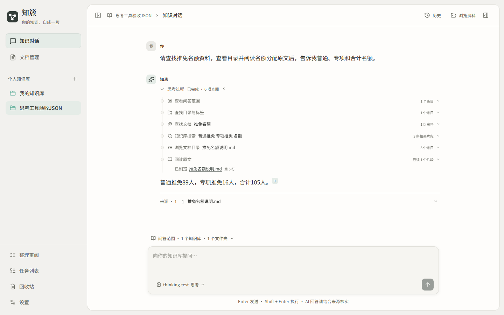

# 快速模式与思考模式

知簇的两种模式共用聊天模型连接、知识库权限、检索服务、对话历史、流式回答和引用阅读器。区别在于如何查阅资料：快速模式由程序固定检索一次；思考模式允许模型在受限的只读工具中选择下一步，继续找文档、查看目录或读取原文，再组织回答。

过程栏记录真实工具活动与结果，不展示模型隐藏推理。规划请求返回的自由文本不会拼进正式答案，也不会当作已经完成的资料核对过程。

下面为独立验收站点的实际界面。示例资料与模型响应用于受控测试，工具执行、范围校验、来源读取和页面渲染均走真实应用链路。

## 横向对比

| 维度 | 快速模式 | 思考模式 |
| --- | --- | --- |
| 请求值 | `retrieval_mode=direct` | `retrieval_mode=model` |
| 谁决定查阅步骤 | 程序固定流程 | 模型提出工具请求，程序验证并执行 |
| 主要流程 | 原问题或明确追问 → 一次检索 → 筛选证据 → 回答 | 规划 → 只读工具 → 工具反馈 → 继续或停止 → 回答 |
| 聊天模型 | 使用用户选中的模型 | 使用用户选中的模型，两种模式可以选择同一个模型 |
| 规划模型请求 | 没有 | 最多 6 次；每次最多 30 秒，累计规划调用最多 90 秒，不自动重试 |
| 模型可主动调用工具 | 不提供工具菜单 | 提供下表中的 6 个只读工具 |
| 知识搜索 | 程序固定执行一次，最多取 16 个候选片段 | 最多 2 个实际搜索轮次、共 3 次搜索，可改关键词和收窄范围 |
| 关键词与向量 | 共用混合检索；无可用向量时使用关键词 | 共用同一检索服务；不会因为开启思考而更换向量模型 |
| 文档与章节阅读 | 使用检索返回的文本片段 | 除检索片段外，可以查看文档列表、章节目录，按章节或 PDF 页码读取原文片段 |
| 原范围约束 | 用户所选知识库、文件夹、标签、文档等条件 | 相同约束；模型添加的条件只能与原范围取交集 |
| 上下文 | 最终证据最多约 24,000 字符，历史约 6,000 字符 | 同样的最终证据和历史预算；工具反馈另有上限 |
| 正式答案 | 统一通过聊天模型流式生成，使用真实引用白名单 | 同一生成和引用机制；规划正文与最终答案分离 |
| 过程展示 | 固定知识搜索的状态、范围、查询和结果数 | 工具时间线、范围与查询、目录和文档查阅、可打开的阅读来源 |
| 耗时与用量 | 步骤较少，适合明确、单一问题 | 通常增加模型请求、工具反馈和等待时间，不保证每次都更准确 |
| 适合的问题 | 已知主题、定义、某个数字、直接查找 | 需要找对文档、跨章节核对、调整关键词、先浏览再定位的问题 |
| 失败处理 | 明确显示检索或模型错误 | 规划异常时，在未提出收窄条件且预算允许时使用有限直接检索；不会因为非法筛选而回退到全范围 |

开启思考不等于启用服务商的某种模型权重，也没有自动设置 `reasoning_effort`。原生工具能力来自已保存的模型连接配置；切换模型名称后，仍需确认对应服务确实支持工具调用。没有原生工具能力声明时，使用结构化 JSON 规划路径，执行同一组服务端工具。

## 思考模式的六个工具

| 工具 | 用途 | 关键限制 |
| --- | --- | --- |
| `get_current_scope` | 获取当前知识库及已选文件夹、标签的合法 ID 和名称 | 只返回当前范围的元数据，不返回正文 |
| `list_scope_metadata` | 按名称或分页查找可用知识库、文件夹和标签 | 每页最多 30 项，结果始终在会话范围内 |
| `list_documents` | 按文档名称、目录和标签等条件查找实际文档 | 每页最多 20 项；必须在原范围内，不提供未授权文件信息 |
| `search_knowledge` | 关键词和可用向量的混合检索，返回相关片段 | 最多 3 次、2 轮；同查询同范围不重复执行，新增筛选不能放宽原条件 |
| `get_document_outline` | 查看已发现文档的章节标题及来源位置 | 先由搜索或文档列表取得真实文档 ID；每页最多 20 个章节，不读取裸文件 |
| `read_document` | 按章节、PDF 页码或分页读取文档中的实际文本片段 | 先发现文档；单次最多 4 个片段，正文响应最多约 10,000 字符；结果可进入最终引用证据 |

全程总工具请求最多 12 次，其中范围和目录标签工具合计最多 3 次，三个文档工具合计最多 4 次。单轮工具反馈总预算约 12,000 字符。工具预算达到上限后，使用已经取得且仍有效的证据回答，不为凑步骤强制调用所有工具。

读取文档时，服务端同时检查会话原范围与先前发现该文档时的真实范围。文档移出目录、被删除、标签条件失效或权限撤回后，不能仅凭旧 ID 继续读取。公开过程在消息查询和 SSE 回放时再次核对来源；不可用的文档名称、片段和链接会被遮蔽。

这些工具只读取知识库，不包含联网搜索、Shell、Python 执行或写文件功能；也不能直接移动、删除或修改资料。整理资料使用另一个带审批的流程。

## 底层 Agent 的实际实现

| 功能入口 | 当前实现 | 模型能做的事 |
| --- | --- | --- |
| 快速知识问答 | 自研固定 RAG 流程 | 根据程序选出的证据生成回答，没有自主工具循环 |
| 思考知识问答 | 自研 `SearchPlanner` 与有界工具循环，Pydantic 验证参数，HTTP 兼容模型接口 | 提出只读工具请求；工具执行、范围、次数和来源校验都由程序控制 |
| 通用整理 Agent | LangChain `create_agent` 生成结构化计划，LangGraph 管理 Plan、Review、Execute、Verify 及 PostgreSQL 检查点 | 用只读工具查资料并提出方案；审批后的写入由事务执行器完成 |
| 当前侧栏的整理审阅 | 自研有界 JSON 规划与共用审批、执行、审计、撤销机制 | 对所选资料提出标签、文件夹等整理方案，等待用户批准 |

因此，聊天思考模式目前使用自研编排；项目中也确实使用了 LangChain 和 LangGraph，但不能把所有聊天请求都称作由它们驱动。

通用整理 Agent 的只读工具为 `list_knowledge_bases`、`list_folders`、`list_tags`、`list_documents`、`get_document`、`search_knowledge`、`get_unclassified_documents`。这些是整理入口的工具，不会自动出现在思考聊天中。创建文件夹、移动资料、改标签、重命名和软删除等属于经批准的计划操作。

## 过程展示与可靠性

新消息按实际 `call_id` 合并工具的运行、完成或失败状态，内部向量检索等子阶段不会提前把外层工具显示为已完成。运行中可以看到当前步骤；完成后收起总过程，每步可展开查看细节。正文阅读来源复用现有引用预览及阅读器，保留真实位置和知识库信息。

历史消息继续兼容旧的 `search_round_summary`、关键词及最终上下文数量。旧记录没有保存的工具活动不会补造。界面不会把耗时当思考深度，也不展示提供方隐藏推理或未经核实的规划叙述。

## 实现入口

- [聊天任务与最终生成](../backend/app/services/chat.py)
- [思考工具规划与循环](../backend/app/retrieval/chat_tools.py)
- [范围交集](../backend/app/retrieval/tool_scope.py)
- [文档发现与正文读取](../backend/app/retrieval/tool_documents.py)
- [公开活动与回放来源校验](../backend/app/retrieval/tool_activity.py)
- [前端过程时间线](../frontend/src/features/chat/ChatProgress.tsx)
- [通用整理 Agent 的 LangChain 规划](../backend/app/agent/planner.py)
- [LangGraph 审批图](../backend/app/agent/graph.py)

框架概念参考 [LangChain 自定义工作流](https://docs.langchain.com/oss/python/langchain/multi-agent/custom-workflow)与[流式事件](https://docs.langchain.com/oss/python/langchain/streaming)；本项目具体行为以上述实现为准。

本轮实际测试范围与常用服务更新记录见[思考工具与过程展示验收](thinking-mode-validation.md)。
