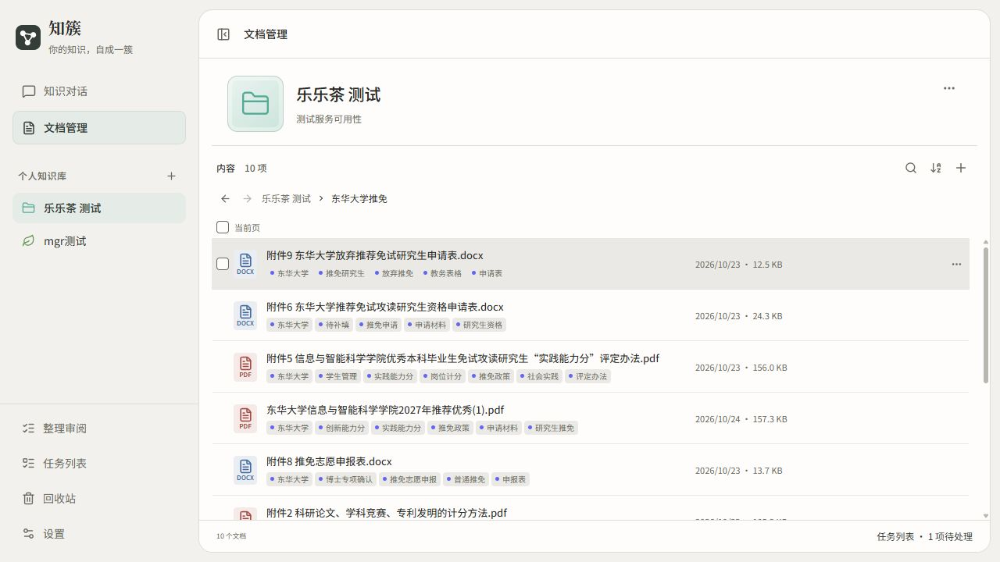
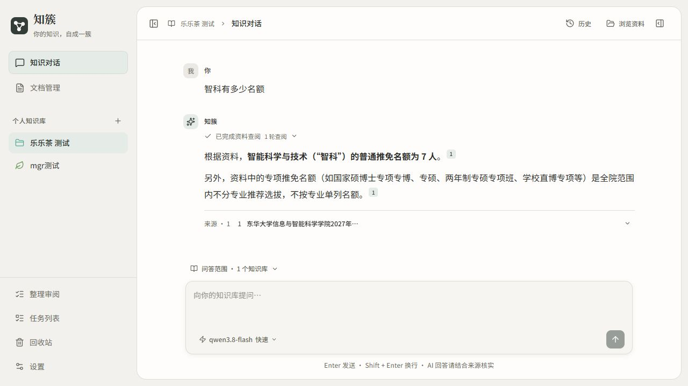
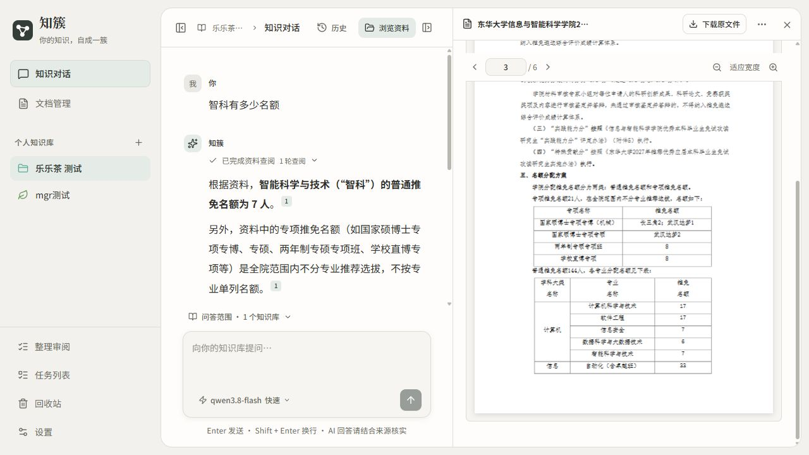

# 知簇知识库 Demo 阶段汇报

知簇是参考腾讯 ima 的个人知识库使用思路实现的 Web Demo。本阶段围绕一个目标展开：让用户导入自己的资料，按指定范围查找信息，并通过带引用的问答回到原文核实。

## 已实现的主要功能

| 功能 | 当前实现 |
| --- | --- |
| 资料导入与管理 | 支持 PDF、Word、Markdown、TXT、PPTX 等格式；通过知识库、文件夹和标签组织资料，保留原文件 |
| 知识检索 | 支持关键词检索与向量检索；可以限定知识库、文件夹和标签范围 |
| 知识问答 | 检索相关资料后生成回答，支持多轮对话、流式显示和来源引用 |
| 原文核实 | 点击回答中的引用，打开对应文档，并定位到 PDF 页码或其他格式的来源位置 |

此外，还实现了后台处理任务、失败重试、回收站，以及需要用户审阅批准的资料整理功能。

## 功能演示

以已导入的推免政策资料为例，展示资料管理、问答和来源核实这三个连续环节。

### 资料已进入知识库

将政策正文和附件放入同一文件夹，可以看到不同格式的文档及其标签，便于按主题管理。

### 对知识库提出问题

示例问题为“智科有多少名额”。这条已有问答根据资料回答：智能科学与技术专业的普通推免名额为 7 人，并附上来源引用。

### 点击引用核对原文

点击引用后，右侧打开政策 PDF 的第 3 页，可以在名额分配表中核对“智能科学与技术 7”。这一环节把生成的答案与原始资料连接起来。

## 技术栈与系统结构

| 层次 | 技术与作用 |
| --- | --- |
| 前端 | React、TypeScript、Vite，实现资料管理、聊天、阅读和设置界面 |
| 后端 | Python、FastAPI，实现上传、检索、对话和业务接口 |
| 数据库 | PostgreSQL、pgvector，保存文档信息、文本片段、向量、会话和任务状态 |
| 后台处理 | 独立 Python worker，执行文件解析、索引、摘要和问答生成等任务 |
| 模型连接 | 聊天模型与 Embedding 模型分别通过兼容接口调用 |
| 部署 | Docker Compose 组织服务，Nginx 提供前端页面并转发接口请求 |

运行时由前端服务、API、worker 和数据库四个常驻服务组成。上传接口保存文件并创建任务，耗时处理交给 worker，页面可以查看处理状态。

## 基本实现逻辑

采用 RAG，即检索增强生成：先从用户资料中找证据，再把证据交给模型组织回答。

**资料入库：** 上传文件 → 提取正文并保留来源位置 → 按段落等结构切分文本 → 生成向量并保存索引。摘要和标签建议在后台继续处理。

**知识问答：** 用户提问并选择范围 → 关键词与向量检索 → 融合排序、减少重复片段 → 将相关片段提供给聊天模型 → 流式返回带引用的回答 → 点击引用核对原文。

关键词检索有利于查找具体名称和术语，向量检索用于补充表达不同但含义相近的内容。模型负责理解和组织语言；系统负责文件处理、范围约束、检索、状态管理和引用定位。当前没有训练自有模型。

## 当前边界与后续计划

当前完成的是本地优先、免登录的单用户 Demo。PDF 解析依赖文本层，尚未实现扫描件 OCR；问答效果仍受资料质量、检索结果和模型能力影响，引用用于帮助核实，不能保证回答始终正确。

后续优先补充登录与访问控制，再扩展 OCR，并用固定问题集持续评估检索和回答质量。本阶段已打通资料导入、知识检索、问答与原文核实的主要流程。
